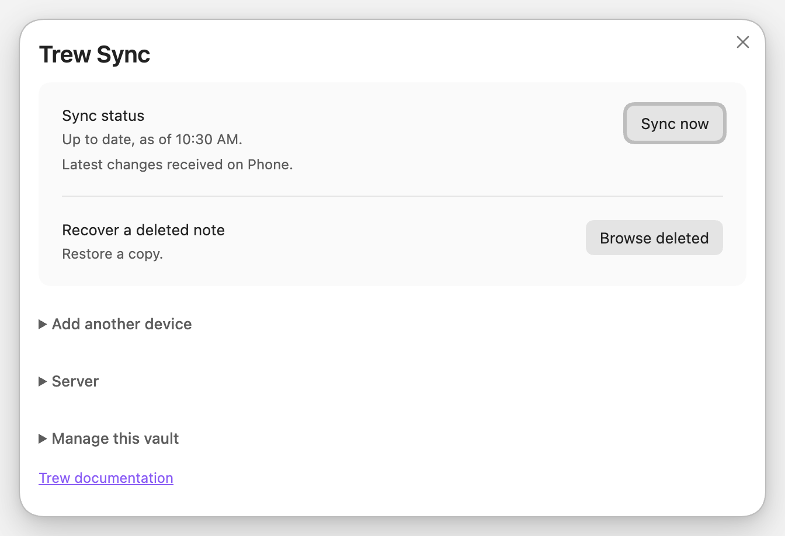
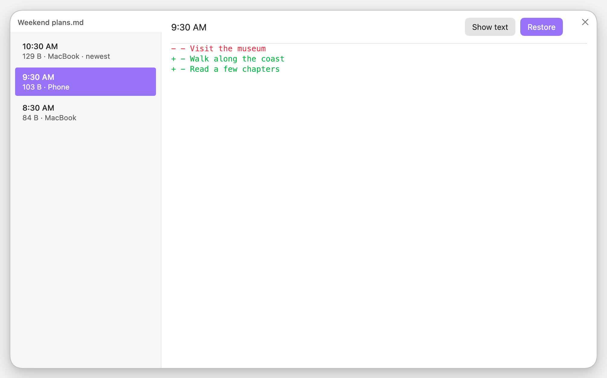

#  TrewSync

**Self-hosted sync for Obsidian that keeps every version and has MCP built in.**

[](https://github.com/waynehoover/trewsync/actions/workflows/ci.yml)
[](https://www.npmjs.com/package/trew-sync)
[](LICENSE)

**[Quickstart](#quickstart)** · [Features](#features) · [How it compares](#how-it-compares) · [Docs](docs/index.md)

Sync your vault across desktop and mobile through a server you run yourself.
Every version of every note is kept until you purge it, so you can always get
an earlier version or a deleted note back. And your AI agents work on the
same notes, through the server, with every edit they make recorded and
undoable.

<picture>
  <source media="(prefers-color-scheme: dark)" srcset="docs/assets/screenshots/panel-dark.png">
  
</picture>

## Features

- **Your server, nothing else.** One small binary or container, with SQLite
  inside and no database to manage. No account, no subscription, no
  telemetry, no fixed device limit.
- **Every version kept.** Browse a note's
  [history](docs/plugin.md#version-history), compare versions, and restore an
  older one or a [deleted note](docs/plugin.md#deleted-notes), all inside
  Obsidian. History stays until you purge it.
- **Go back in time.** Put a folder, or the whole vault, back as it was at a
  date and time you pick. You see a preview first, every device gets the
  result, and one Undo reverses it
  ([restore to an earlier time](docs/plugin.md#restore-a-folder-to-an-earlier-time)).
- **Conflicts never overwrite.** Edits from two devices are merged when they
  can be. When they cannot, both versions are kept
  [side by side](docs/plugin.md#conflicts) for you to review.
- **MCP built into the server.** An agent such as Claude Code searches, reads
  and edits the same notes your devices sync, with no second copy of the
  vault and no extra plugin ([connect an agent](docs/agent.md)).
- **Agent edits you can undo.** An agent changes a note only by exact edits,
  never by overwriting it whole. Every write is recorded and can be undone
  from Obsidian, from the server, or by the agent.
- **Light on your phone.** [Attachments on demand](docs/plugin.md#attachments-on-demand)
  leaves large files on the server until you open a note that uses them.
- **Settings sync.** Obsidian's settings, themes, snippets and plugin
  settings, shared among your phones, your desktops, or all of them
  ([settings sync](docs/plugin.md#settings-sync)).
- **Works without Obsidian.** A [command-line client](docs/client.md)
  keeps a copy of the vault on a NAS or server, read-only or
  two-way.
- **A Git history, if you want one.** The server can push your vault's history
  to a [private repository](docs/git-export.md), so no device needs a Git
  plugin.

<picture>
  <source media="(prefers-color-scheme: dark)" srcset="docs/assets/screenshots/changes-dark.png">
  
</picture>

## How it compares

| | TrewSync | Obsidian Sync | Self-hosted LiveSync |
|---|---|---|---|
| Runs on | Your server | Obsidian's servers | Your backend, such as CouchDB or S3-compatible storage |
| Cost | Free (MIT); you pay for hosting | Subscription | Open source; you pay for hosting |
| MCP for AI agents | **Built in**, with every edit recorded and undoable | Not built in | Not built in |
| End-to-end encryption | **None.** The server reads your notes | Available | Available |

Pick TrewSync for history on your own server and agents on the same notes.
Pick one of the others if the server must not read your notes, if you would
rather not run one, or if you need iOS or Windows, which Obsidian Sync
supports. [Is TrewSync right for you?](docs/compared.md) has the longer
answer.

## Quickstart

You need a Linux or macOS machine with Docker, and
[Tailscale](https://tailscale.com) on it and on each device. Back up an
existing vault before its first sync, and turn off any other sync service for
it.

1. **Run the server.**

   ```bash
   git clone https://github.com/waynehoover/trewsync.git && cd trewsync
   docker compose up -d
   ```

2. **Give it a secure address.** `tailscale serve --bg 3003` publishes it to
   your tailnet over HTTPS. Take the address `tailscale serve status` reports
   and replace `https://` with `wss://`, for example
   `wss://homelab.example.ts.net`.

3. **Make an invite** for your first device. It works once and expires after
   one hour.

   ```bash
   docker compose exec trew /trewd invite -url wss://homelab.example.ts.net
   ```

4. **Install the plugin and pair.** In Obsidian, install **TrewSync** from
   **Settings → Community plugins**, enable it, paste the invite and press
   **Pair**. Keep Obsidian open until the first sync finishes.

5. **Add your other devices.** On the paired device choose **Add another device
   → Create invite**, and scan the QR code with the next one.

Next: [connect an agent](docs/agent.md). No Tailscale or Docker?
[Server setup](docs/server.md) covers Caddy and a plain binary. Or hand
[llm.md](llm.md) to your agent and let it do the setup.

## Requirements

- Obsidian 1.7.2 or newer. Plugin 0.16 needs the server `trewd` 0.15.0 or
  later.
- A vault on local storage, not a network filesystem, with no other sync
  service on it.
- A server you maintain and back up. TrewSync is an early project, built for
  one person's devices.
- Files up to 64 MiB each by default. Plugins themselves and other hidden
  files do not sync ([what is not synced](docs/plugin.md#what-is-not-synced)).

### Platforms

| Platform | Status | What that means |
|---|---|---|
| macOS | Supported | The tests run here. |
| Linux | Supported | The tests run here. |
| Android | Supported | Sync runs while Obsidian is open in the foreground. Keep the vault in App storage. |
| iOS | Untested | The same code as on Android, but no test has run on an iPhone or iPad: background suspension, iCloud Drive vaults and the iOS file system are untested. The plugin pairs, and says so in its panel for as long as it runs. |
| Windows | Not supported | No test runs on Windows. The plugin pairs, and says so in its panel and status bar for as long as it runs. A note whose name Windows cannot hold (a device name such as `CON` or `COM1`, one of the characters Windows forbids, or a name ending in a dot or a space) is listed as needing attention instead of syncing, and stays on your other devices. |

## Privacy

**The server reads your notes.** There is no end-to-end encryption: the server
holds every note, version and filename in plaintext, which is what lets the
MCP endpoint work. Keep its disk and backups on encrypted storage, keep the
connection behind TLS, and give an MCP token only to an agent and model
provider you would trust with every note. If you need a server that cannot
read what it stores, choose an end-to-end encrypted service instead.
[Security and privacy](docs/security.md) has the full picture.

## Documentation

| I want to… | Guide |
|---|---|
| Set up TrewSync with an agent's help | [Agent installation guide](llm.md) |
| Run TrewSync on my server | [Server setup](docs/server.md) |
| Pair devices or recover a note | [Obsidian plugin](docs/plugin.md) |
| Let an agent read or edit my notes | [Connect an agent](docs/agent.md) |
| Keep a copy without Obsidian | [Command-line client](docs/client.md) |
| Back up, restore, or free server space | [Server maintenance](docs/server-operations.md) |
| Decide whether TrewSync fits | [How it compares](docs/compared.md) |
| Build or contribute | [Developer documentation](docs/development.md) |

Questions and bugs go to
[GitHub issues](https://github.com/waynehoover/trewsync/issues); security
problems go privately, as [SECURITY.md](SECURITY.md) describes. Changes are in
[CHANGELOG.md](CHANGELOG.md). TrewSync is free and open source under the
[MIT license](LICENSE).

## Disclosures

In the terms of Obsidian's developer policies:

- **Payment:** none. TrewSync is free, open-source software.
- **Account:** none for TrewSync, but the plugin needs a TrewSync server,
  which you run yourself. The quickstart reaches that server over Tailscale,
  which has accounts of its own; [server setup](docs/server.md) also shows
  Caddy instead.
- **Network use:** the plugin connects only to the TrewSync server you pair it
  with, at the address the invite names or one you set later, to sync your
  notes and attachments, show their history, and manage this vault's devices
  and invites. It contacts no other service.
- **Your notes on that server:** the server stores notes, their history and
  their names in plaintext. With its MCP endpoint turned on, an agent holding
  a token can read every note, and what it reads reaches that agent's model
  provider.
- **Files outside the vault:** the plugin reads and writes only inside the
  vault. A note deleted on another device goes to the system trash, or the
  vault's `.trash` if that fails. On Obsidian 1.11.4 and later the device's
  token is kept in Obsidian's keychain, which belongs to Obsidian on that
  device rather than to the vault.
- **Every file in the vault:** to sync a vault the plugin lists and reads
  every file in it, notes and attachments alike, except what it is set never
  to sync.
- **Clipboard:** the plugin writes to the clipboard only when you press Copy,
  on an invite or on the activity log's diagnostics. It never reads the
  clipboard.
- **Telemetry:** none, in the plugin or the server. Neither reports anything
  to the author or anyone else. The server contacts another service only when
  its operator asks it to: pushing to the Git remote they name, or downloading
  a release from GitHub with `trewd update`.
- **Ads:** none.
- **Closed source:** none. Everything is in this repository.
- **Fork:** TrewSync is a fork of
  [Basalt Sync](https://github.com/waynehoover/basalt-sync), made by its own
  author, Wayne Hoover, from the same GitHub account.
