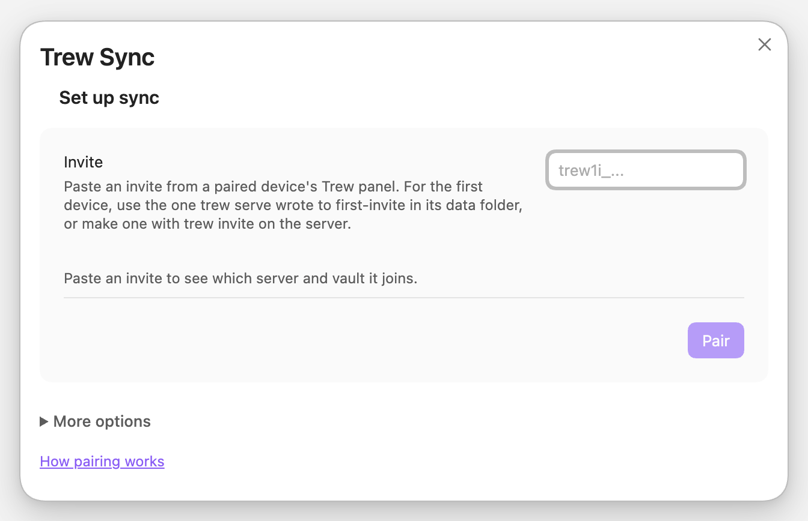
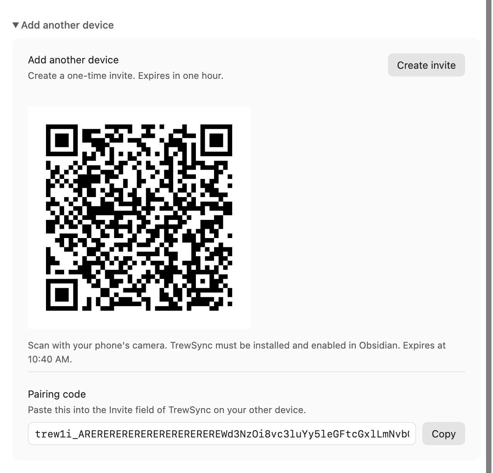
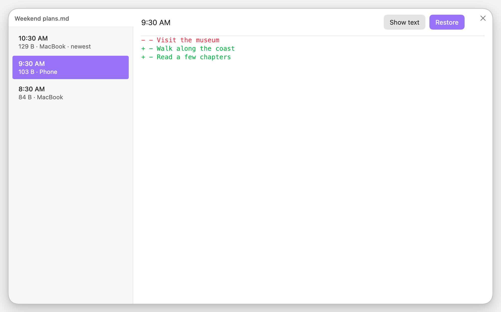
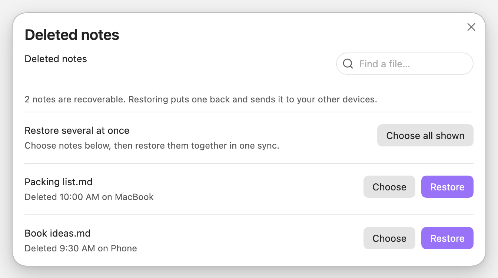
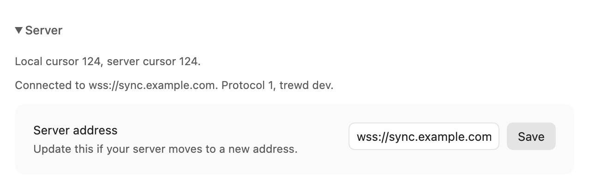
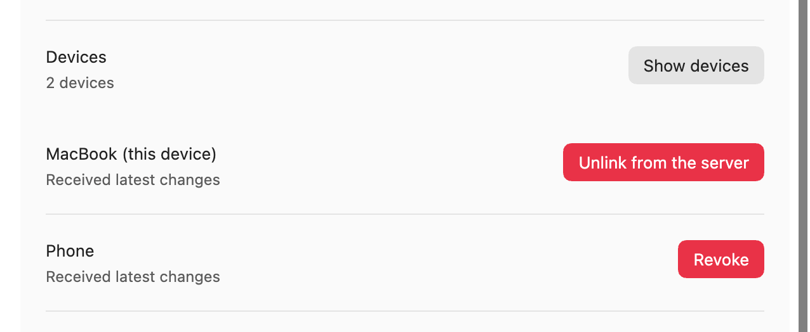

# Use TrewSync in Obsidian

[Documentation](index.md) · [Server setup](server.md) · [Security and privacy](security.md)

TrewSync syncs your notes and attachments, shows what it is doing, and lets
you recover earlier versions, all from inside Obsidian. You need a
[configured server](server.md) and Obsidian **1.7.2 or newer**.

Before you pair:

- Use a local vault on macOS, Linux or Android. iOS is untested and Windows
  is not supported. The plugin still pairs there, and says so in its panel;
  the [platform table](../README.md#platforms) says what that means.
- Back up an existing vault.
- Turn off other sync services for that vault. Each device keeps its own
  local copy.

## Install

1. In Obsidian, open **Settings → Community plugins**, turn community plugins
   on if they are off, choose **Browse**, search for **TrewSync**, install it
   and enable it. Or open its
   [directory page](https://community.obsidian.md/plugins/trew-sync) and
   choose **Add to Obsidian**.
2. Open the TrewSync ribbon icon and choose **Sync settings** at the bottom of
   its menu, or run **TrewSync: Show status** from the command palette. Either
   opens the TrewSync panel, where you pair. (This is not
   [settings sync](#settings-sync), which is a choice inside the panel.)

Obsidian offers each new release under **Community plugins → Check for
updates**. When a release changes the protocol, upgrade the server before its
clients.

**Server version.** Plugin 0.16 needs `trewd` 0.15.0 or later. It speaks
protocol 5 only, and a 0.14 or older server refuses it at the handshake, for
everything and not only restore. Upgrade the server first; see
[upgrade order](server.md#upgrade-order).

### Install by hand or with BRAT

To run a release before Obsidian offers it, download `main.js`,
`manifest.json` and `styles.css` from the
[plugin release](https://github.com/waynehoover/trewsync/releases) (plugin
releases use a plain `X.Y.Z` version; skip `server/v…` and `cli/v…`) into
`<vault>/.obsidian/plugins/trew-sync/`, using your configuration folder if it
is not `.obsidian`, and reload Obsidian. Where a file manager cannot reach the
vault, as on a phone, use the community plugin **BRAT**: install and enable
it, choose **Add beta plugin** in its settings, and enter
`waynehoover/trewsync`. BRAT then keeps TrewSync up to date.

Settings sync never carries TrewSync itself, so each device needs it installed.

## Pairing

Every device joins with an invite: a single-use string starting `trew1i_` that
carries the server's address and the vault's name. The setup screen has one
field, **Invite**, and a **Pair** button.

<details>
<summary>See the setup screen</summary>

<picture>
  <source media="(prefers-color-scheme: dark)" srcset="assets/screenshots/pairing-dark.png">
  
</picture>

</details>

### Start your first device

1. Get the first invite from your server: run `trewd invite` there with the
   address your devices use, as [server setup](server.md#the-first-device)
   shows. The `first-invite` file in the server's data directory works only if
   the server was started with that address (`-url`), or as a trial on one
   machine (`-localhost`); otherwise it names a guessed address.
2. Paste it into **Invite**. TrewSync shows which server it points to, and
   which vault if it is not `default`. Check that address.
3. Press **Pair**, then wait for sync to finish before adding another device.

To rename this device or skip a folder on it, open **More options** before
you pair.

There is no recovery key to write down. Your notes and their history live on
the server, so losing every device loses no synced note: run `trewd invite` on
the server to pair a new one.

### Add another device

1. On a paired device, open **Add another device → Create invite**.
2. On the new device, [install](#install) and enable TrewSync, then scan the
   QR code. Or copy the pairing code and paste it into **Invite**.
3. Check the server (and vault) named under the field, then press **Pair**.
4. If this vault already contains files, TrewSync asks you to confirm
   combining them with your synced vault. An older copy can bring back files
   moved or deleted elsewhere. **Cancel** leaves your files and invite
   untouched.
5. If **Review your first sync** appears, check the counts and choose
   **Continue sync**. Nothing syncs until you do: closing the review pauses
   sync, and clicking the status bar brings the review back. On desktop it
   opens in the main Obsidian window, even if you paired from a separate
   Settings window. An empty vault, one whose files already match the
   server's, or a first sync that was interrupted skips the review and starts
   downloading.
6. Keep Obsidian open until the sync finishes.

TrewSync never clears or moves existing files during pairing. For a fresh
copy, pair a new empty vault and keep the old one as a backup.

An invite works once and expires after one hour. If it expires, create a new
one. If no paired device remains, run `trewd invite` on the server and paste
what it prints into the same field. There is no fixed device limit.

If pairing is interrupted after the invite was sent, TrewSync keeps the pairing
and finishes it on the next attempt, even after the invite has expired. A
refused invite (unknown, already used, expired or cancelled) leaves nothing
saved. An invite or recovery key from Basalt Sync does not pair with TrewSync;
the field says so.

<details>
<summary>See the QR code and pairing code</summary>

<picture>
  <source media="(prefers-color-scheme: dark)" srcset="assets/screenshots/invite-dark.png">
  
</picture>

</details>

### Where this device's token is kept

A paired device connects with its own random token.

- **Obsidian 1.11.4 and later:** the token lives in Obsidian's keychain
  (**Settings → Keychain** lists it as `trew-<vault>-<device>`). The plugin's
  `data.json` keeps only the rest of the pairing.
- **Older Obsidian:** the token stays in `data.json`.

The keychain belongs to Obsidian on this device, not to the vault folder. So
a backup, an iCloud or git copy, or a copy of `.obsidian` does not carry the
token, and a copy opened elsewhere cannot sync as this device. Its panel
shows **Pair this device again**; a new invite adds it as a device of its
own.

One exception: after pairing, or after an older Obsidian is first upgraded,
`data.json` still holds the token until the next time Obsidian starts. Until
that restart, a copy of `.obsidian` carries it. If the keychain cannot store
the token at all, it stays in `data.json`, sync carries on, and a notice
says so.

**Renaming a vault.** On a desktop the token follows the vault to its new
name. On a phone every vault shares one keychain, so a renamed vault cannot
tell its own entry from a copy's, and it stops, naming the old entry.

**If the token cannot be found** (a reset keychain, or a vault renamed on a
phone), TrewSync stops and offers **Pair this device again**. No note is
lost: pair with a new invite, confirm combining the notes, and it syncs as a
new device. Then revoke the old device under **Devices**, and after a rename
on a phone also remove the old entry in **Settings → Keychain**.

## What it does

TrewSync syncs shortly after each edit, checks periodically while Obsidian is
open, and reconnects after a dropped connection. **Sync now** syncs
immediately, and retries files after you fix a problem. Use **Reconnect**
when offline and **Resume sync** when paused.

The panel shows the result, any files needing attention, and the server's
address and version (useful when diagnosing a connection problem). On
desktop, the status bar shows a cloud with a check when synced: hover for
details, or click for quick actions and settings.

A sync that brings in several files counts them: "Downloading 1,280 of 3,000
files." Other long transfers show the current file and how much data has
moved. Keep Obsidian open until sync finishes.

Once this device has finished syncing, the delivery line says which other
devices have received the latest changes. If it is waiting for your phone,
open Obsidian there: a disconnected device cannot confirm anything until it
reconnects.

| Status | What to do |
|---|---|
| Unpaired | Pair this vault. |
| Paused | Choose **Resume sync** from the TrewSync menu. |
| Connecting, loading history, or syncing | Keep Obsidian open until sync finishes. |
| Synced | Nothing. No outstanding work was reported. |
| Needs attention | Open the panel and follow the reason shown for each file. |
| Failed or offline | Check the connection and the reported error; TrewSync retries temporary failures. |
| Stopped | Follow the panel's instructions. Retrying alone will not fix it. |

- **Protocol mismatch:** update the server and plugin to compatible releases.
- **Server restored from a backup:** TrewSync catches up by itself; see
  [rejoining a restored server](#rejoining-a-restored-server) for the one
  case that stops.
- **Unreadable local state:** preserve that state and your notes before
  attempting recovery. Deleting the plugin's files is not a general
  troubleshooting step.

## Activity and quick actions

Click the TrewSync status icon or tap its ribbon icon for **Sync activity**,
**Review conflicts**, **Preview sync**, history, and settings. **Pause sync**
stops this device until you resume it or restart Obsidian.

- **Sync activity** keeps the latest 300 events on this device across
  restarts. Search by filename, or filter errors and conflicts. Note contents
  and credentials are never recorded, and **Copy diagnostics** leaves out
  filenames too.
- **Preview sync** shows planned changes without writing notes. It is an
  estimate: files are checked again when sync runs.
- **A review opens by itself** before populated vaults are combined (with
  upload, download and preserved-copy counts), and when you delete a whole
  folder holding several synced files. Choose **Pause sync** if the changes
  are unexpected.
- **TrewSync: Verify vault contents** is for a file that changed outside
  Obsidian but did not sync. It reads every file again, so it takes longer
  than a normal sync.

<details>
<summary>See activity, conflict review, and first-sync previews</summary>

- [Recent activity](assets/screenshots/activity-phone.png)
  ([dark theme](assets/screenshots/activity-phone-dark.png))
- [Compare a conflict](assets/screenshots/conflicts-phone.png)
  ([dark theme](assets/screenshots/conflicts-phone-dark.png))
- [Review first-sync changes](assets/screenshots/preview-phone.png)
  ([dark theme](assets/screenshots/preview-phone-dark.png))

These phone layouts were captured in desktop Obsidian's mobile styles.

</details>

## Version history

Run **TrewSync: Show version history** for the open note, or use the note's
right-click menu. Choose a version to read it or compare it with the local
copy; **Load more** goes further back. Tab or the arrow keys move between
versions. Attachments and large notes show their details without a text
preview: restore a copy to open the complete file.

<picture>
  <source media="(prefers-color-scheme: dark)" srcset="assets/screenshots/changes-dark.png">
  
</picture>

**Restore does not overwrite an existing file.** If the original path is
occupied, the copy appears beside it, for example `Note (restored 42).md`.
Restoring also tries to upload the copy to the server, and other devices
receive it when they next sync.

**Undo this change** appears on a version an agent wrote through the server's
[MCP endpoint](agent.md), and on one an undo wrote. The panel names who wrote
it: the agent by its token's label, an undo on the server, or an undo from a
device.

- Unlike Restore, it replaces. It puts back what that operation changed, in
  every note it changed, and every device receives the result. This device's
  unsent changes are sent first.
- If any of those notes has been edited since, here or on a device that has
  synced the edit, nothing is changed. The panel says which note and who
  edited it, and offers **Keep both: write the earlier versions as copies**,
  which writes each earlier version beside its note, as
  `Note (restored 42).md`, and leaves everything else alone.
- An undo can itself be undone. A version already undone shows no undo
  button.

History remains available until the server operator
[purges it](server-operations.md#purge). An agent's version keeps the note's
earlier version for at least 30 days, whatever purge is asked to do; after
that, undoing it may be refused because the earlier version is gone.

## Restore a folder to an earlier time

1. Right-click a folder and choose **TrewSync: restore to an earlier time**.
   Or run **TrewSync: Restore a folder, or the vault, to an earlier time** and
   leave the folder empty to cover every note in the vault.
2. Pick a date and time, in this device's time zone, and press **Preview**.
   Nothing changes yet: the preview counts and lists the files that would be
   put back and the files made since that would be removed.
3. Press **Restore** to do exactly that, or close the window to do nothing.

Every device receives the restore as it syncs. **Undo** in the same window
puts back everything the restore replaced, as one change; so does **Undo this
change** in the version history of any note it touched. Nothing is lost
either way: every version it replaced stays in the history.

What to expect:

- **The time is the server's.** It means what the server had received by
  then. A note edited on an offline phone belongs to the time the phone sent
  it, not the time on the phone's clock. The preview says the exact moment it
  found.
- **Only the folder changes.** A note moved into the folder since then stays
  where it arrived, and the preview says how many. A note moved out since is
  put back in the folder, and the one where it went is left alone, so you
  then have both.
- **Settings never change.** A restore is of notes and attachments.
- **You restore what you previewed.** If a note is saved anywhere between
  the preview and Restore, Restore is refused and the window asks for a new
  preview.
- **Limits.** A restore of more than 10,000 files is refused; restore one
  folder at a time. A time before the oldest history the server recorded a
  time for, or one whose history has been
  [purged](server-operations.md#purge), is refused rather than guessed. The
  server must be version 0.15 or later.

## Deleted notes

Press **Browse deleted**, select the note, and restore it.

- **Find a file** filters the list by filename. It searches only what is
  loaded; **Show older** loads the next page of older deletions.
- To restore several at once, press **Choose** on each note, or **Choose all
  shown**, then **Restore N**. They are restored together in one sync, into
  names nothing already occupies.
- A note whose content has been purged is listed without a restore button.
- If the connection fails, reconnect and choose **Try again**.

<details>
<summary>See deleted notes</summary>

<picture>
  <source media="(prefers-color-scheme: dark)" srcset="assets/screenshots/deleted-dark.png">
  
</picture>

</details>

A deletion received from another device goes to the system trash, or the
vault's `.trash` if necessary. If you edit a note while another device deletes
it, TrewSync keeps the edit and sends it back as a new version.

**Folders.** Deleting or renaming a folder removes it from your other devices
too, once nothing is left in it there. Its notes go to the trash on those
devices, as any deletion does; the emptied folder itself is removed, not
trashed.

- A folder that still holds something on another device stays there, and
  comes back on the device where you deleted it. That something can be a
  note written or edited there while it was offline, or a file TrewSync never
  syncs, such as a name starting with a dot. (The `.DS_Store` the macOS
  Finder leaves behind does not count: it is removed with the folder.)
- Deleted folders are not listed under **Browse deleted**; the notes that
  were in them are.
- Folders deleted with an earlier version of TrewSync may still be on your
  other devices. The device a folder was deleted on removes it from the
  others on its first sync with this version, as long as it still has its
  sync record of the folder. If an old folder stays, delete it again.

## Conflicts

TrewSync tries to combine edits made on different devices. When it cannot do
that safely, it keeps both versions:

```text
Meeting notes.md
Meeting notes (Conflicted copy laptop 202608311412).md
```

The name in the copy says whose words are in it:

- **Another device's name** (here, `laptop`): the version that device wrote,
  kept beside the one you have.
- **An agent's name**, such as `Claude on Mac`: an agent's edit, named by
  the label its access token was given.
- **This device's own name**: something that was on this device, such as an
  edit saved while a newer version was arriving.

Characters a file name cannot hold are replaced, and a long name is
shortened.

To resolve one, choose **Review conflicts** from the TrewSync menu. Compare
the original and the preserved copy, then keep either one or edit a combined
version. **Decide later** leaves both files in place. If a file changes while
you review it, refresh the comparison before choosing. The result syncs to
your other devices.

Attachments and large notes open separately for comparison. You can also
combine files by hand and delete the extra copy.

Keeping both versions on a conflict is not a promise that sync never changes
an open file: successful merges and ordinary downloads do update the original
note.

## Settings sync

Settings sync is off until you turn it on, on each device: in the TrewSync
panel, **Manage this vault → Sync settings**.

| Synced? | What |
|---|---|
| Always | Obsidian's own settings, themes and CSS snippets, including core plugins and their settings (Daily notes, Templates and the rest). |
| Only with [plugin settings sync](#plugin-settings) | Community plugins' own settings. |
| Never | Community plugins themselves, and the workspace layout. |

Names you have told this device to skip are skipped in the settings folder
too. Plugin 0.16 needs a server of 0.15.0 or later for everything, settings
sync included; see [Install](#install).

**Whom a device shares its settings with.** **Sync settings** is one choice,
made on each device:

- **Off**, the default.
- **Mobile only**, on a phone or tablet: shared with your other phones and
  tablets set to Mobile only. On a desktop the same choice is **Desktop
  only**, shared with your other desktops set to Desktop only.
- **Mobile and desktop**: shared with every device set to Mobile and desktop.

Every device keeps its own settings folder, `.obsidian` or whatever Obsidian
runs there, and nothing needs renaming. The server keeps each group's
settings in a folder of its own (`.obsidian` for Mobile and desktop,
`.obsidian-mobile` and `.obsidian-desktop` for the others), and TrewSync maps
it onto the folder each device runs. Changing the choice later works like
turning settings sync on: the first-time question comes back where there is
one, and the group you leave keeps its settings on the server.

**The first time.** TrewSync first saves a copy of this device's settings as
they were, in a `settings-before-sync-` folder inside the plugin's own
folder, and says where. (Uninstalling the plugin removes that folder with
it.) Then it compares this device's settings with the group's:

- **Something differs, or the group has deleted a setting this device has:**
  it asks which to use, the server's or this device's. With the server's, a
  setting the group deleted goes from this device too, after you apply it.
  The answer is for that first time only.
- **Nothing differs:** it does not ask. This device's settings go to the
  group, and the group's settings that this device lacks wait for you to
  apply them. The same values in another order count as the same.
- **It cannot reach the server** (offline, or in the middle of a sync): it
  asks anyway.

One case it cannot see: a setting renamed on another device, such as a
snippet. This device sends it back to the group under its old name.

**When two devices disagree.** Different settings changed on two devices are
merged, even in the same file. The same setting changed two ways before
either device synced keeps both, as a note does: the device that syncs second
keeps its value, and the other is saved beside the file as a conflicted copy,
which Obsidian ignores. **Review conflicts** lists it as an Obsidian setting.
Keeping the original removes the copy. Keeping the copy, or a combined
version, writes it and reloads Obsidian; a combined version has to be valid
JSON.

**Applying a change.** Obsidian reads its settings when it starts, so a
setting changed on another device waits until you apply it. TrewSync says how
many are waiting, in a notice and in its status. Tap the notice, or run
**Apply synced settings and reload**, and confirm. TrewSync then:

1. Saves a copy of this device's settings as they are, in
   `settings-before-apply` inside the plugin's folder (replaced each time).
2. Saves your open notes, canvases and drawings.
3. Writes the settings and reloads Obsidian.

If Obsidian writes its old setting back as it reloads, TrewSync notices and
offers the change again, rather than sending the old value to your other
devices. A settings file that is not valid JSON is never sent or applied, and
is listed as needing attention.

The server keeps every version of a setting, as it does for a note. Agents
connected over MCP never see settings, and the Git export leaves them out.

### Plugin settings

With settings sync on, **Manage this vault → Sync plugin settings** syncs
each community plugin's settings, its `data.json`, with the same group. It is
off until you turn it on, on each device, and needs a server of 0.15.0 or
later like the rest of plugin 0.16.

The plugins themselves never sync: install and enable them on each device,
and their settings follow. Settings for a plugin a device does not have wait
in its folder until it does.

A change from another device waits until you apply it, as other settings do.
**Apply synced settings** names each plugin whose settings it would change,
and the device the change came from. Turning plugin settings sync on asks the
first-time question again where there is a choice to make, for plugin
settings and the rest together, and saves a copy of this device's settings
first.

- **Secrets.** Plugins sometimes keep API keys or passwords in their
  settings. With plugin settings sync on, those are stored on your server and
  in its backups as they are, as your notes are.
- **Never synced:** the settings of TrewSync itself, and of Obsidian Git,
  Local REST API, Self-hosted LiveSync, Remotely Save, Basalt Sync and
  SuperSync, which sync or control the vault and hold credentials. They are
  recognised by the id in each plugin's manifest, whatever its folder is
  called.
- **BRAT's settings sync** like any plugin's, so every device where you
  install and enable BRAT tracks the same plugins, and installs them itself.
- **To keep one plugin's settings to one device,** add its folder name to
  **Skip these on this device**.

## What is not synced

- **Obsidian's configuration folder**, unless [settings sync](#settings-sync)
  is on. Even then, the workspace layout and community plugins themselves do
  not sync, and plugins' settings sync only with
  [plugin settings sync](#plugin-settings) on as well. The settings of
  TrewSync itself and of the plugins that sync or control a vault never do.
- **Names starting with a dot**, files or folders, at any depth, including
  `.git`, `.trash` and `.trew`. An `.attachments` folder is one of these, so
  attachments kept there stay on the device that has them.
- **Files above the server's limit**, 64 MiB by default. The server operator
  can [adjust the limit](server-reference.md#serve).
- **Paths Obsidian could not hold everywhere:** longer than 1,024 bytes, a
  file or folder name longer than 255 bytes, control characters, backslashes,
  and a few more. A no-break space in a name is fine: Obsidian reads it as an
  ordinary space, and so does TrewSync, so the note syncs under that name and
  the file keeps its own.
- **A path that differs from another only in letter case**, such as
  `Notes/a.md` beside `notes/a.md`, because a case-insensitive disk would
  hold them as one.

The panel lists each refused path with its reason, and the file stays on this
device. Rename it and press **Sync now**. Everything else syncs. Large
attachments need more memory, particularly on phones.

## Phones

**Android syncs only while Obsidian is open in the foreground.** There is no
background service or push notification to wake it. Let changes finish before
you close the app.

Turning the screen off pauses Obsidian and drops its connection within
seconds, so TrewSync keeps the screen on during a sync that runs for more
than a couple of seconds, and lets it sleep again afterwards. Switching apps
or pressing the power button still pauses it; an interrupted sync carries on
where it stopped when Obsidian is open again.

**Keep an Android vault in App storage.** Obsidian asks for a location when
you create a vault, and **Device storage**, the one it marks recommended, is
several times slower for TrewSync to write to: on a Pixel 9 Pro XL a first
sync of 3,000 notes took 2.4 times as long there as in App storage. The
trade-offs: other apps cannot open App storage, and Android deletes it when
Obsidian is uninstalled, which with TrewSync loses only changes that have not
synced yet.

To move a vault you already have:

1. Create a new vault in App storage and install TrewSync there.
2. Pair it with a new invite and let its first sync finish.
3. Remove the old vault and its device.

Obsidian's own settings come across only with
[settings sync](#settings-sync) on.

**iOS has not been tested.** If a first connection is rejected because of its
browser origin, the panel shows an origin hint for the server operator; see
[server connection troubleshooting](server.md#connection-troubleshooting).

### Attachments on demand

A phone does not need every PDF, photo and recording in the vault. Set
**Manage this vault → Attachments on demand** to **Over 1 MB**, **Over
10 MB** or **All attachments**, and a new attachment at least that size stays
on the server. This device downloads it when you open a note that embeds or
links it, or when you tap it.

- Notes, canvases and every other text file always download, whatever their
  size, and so do settings.
- The setting is this device's alone. Your other devices keep downloading
  everything.
- The panel says how many attachments are on the server only, and their
  total size.
- **TrewSync: Download a file kept on the server** fetches any one of them.
  **TrewSync: Download the attachments this note needs** fetches what the
  open note uses.
- Offline, an attachment you open waits and downloads when TrewSync
  reconnects, even if Obsidian restarts in between.
- Once downloaded, an attachment stays and syncs like any other file. If
  another device renames it, it goes back to the server only here, under its
  new name, and downloads again when you open it.
- Turning the setting off downloads everything that was waiting.

**Free space.** Attachments already on the device stay when you turn the
setting on. **Free space** in the panel removes the ones the setting covers
from this device only: each stays on the server and on every other device
that has it. TrewSync first checks that the server holds the file's current
content, by reading both copies in full. A removed copy is deleted, not moved
to the trash, since freeing the space is the point; a file that changed while
it was being removed is kept under a new name instead.

**To free space, use Free space. Deleting a file deletes it everywhere.**

Two limits to know:

- An attachment that is on the server only is not in Obsidian's file list or
  search until it is downloaded, and an embed of one shows as not found until
  then.
- Renaming or deleting a folder here moves or removes only the files here. A
  file that is on the server only stays at its old path on the server, and
  its folder comes back.

## Change the server address

Use this when the same server moves to a new hostname or port. Open **Server
→ Server address**, enter the new address, and press **Save**. TrewSync
checks the connection with this device's existing pairing before saving.
Notes and sync history are kept. Update the address on each device.

<details>
<summary>See server settings</summary>

<picture>
  <source media="(prefers-color-scheme: dark)" srcset="assets/screenshots/server-dark.png">
  
</picture>

</details>

## Devices, and revoking one

Under **Manage this vault**:

- **This device's name → Rename** changes the label used for future activity.
  Existing history and conflict filenames keep their old labels.
- **Devices → Show devices** lists paired devices and outstanding invites.
  Devices with the same name show their IDs so you can tell them apart. A row
  marked **Never connected** may be left by an interrupted pairing.
- **Revoke** stops a device syncing; **Cancel** invalidates an unused invite.
  On the row for this device the same button reads **Unlink from the server**.
  It revokes this device on the server, unlike **Unlink this vault**, which is
  local only.

The server's host can do the same with `trewd devices`, `trewd revoke` and
`trewd uninvite`; see the
[server reference](server-reference.md#invite-devices-revoke-uninvite).

<details>
<summary>See the device list</summary>

<picture>
  <source media="(prefers-color-scheme: dark)" srcset="assets/screenshots/devices-dark.png">
  
</picture>

</details>

Revoking a device stops it receiving and sending changes at once, and cancels
any invites it created. **It cannot erase notes already on that device: they
stay readable there.** See
[what to do after losing a device](security.md#if-a-device-is-lost-or-stolen).
You can revoke any device, including this one and the last one; `trewd invite`
on the server pairs a device again afterwards.

On the revoked device, the panel says it was revoked and shows **Pair this
device again** with an Invite field in place of its usual controls. Its notes
stay where they are, on that device and on the server. Paste or scan a new
invite and press **Pair**: TrewSync asks before combining the vault's notes,
then replaces the old pairing and sync index, as unlinking would. It syncs as
a new device under the same name, still skipping what it skipped.

<details>
<summary>Recovery and server maintenance</summary>

## Rejoining a restored server

When the operator restores the server from a `trewd backup` snapshot, the
server starts a new history, and this device notices at its next connection.
There is nothing to press. It reads the restored history as a fresh listing:

- Files that match agree.
- Files that differ are kept both ways, as a conflict copy.
- Files only this device holds are sent back.
- Nothing is deleted because the restored history lacks it.

A note deleted after that backup was taken can come back; delete it again if
you still want it gone.

The one case that stops is a server data directory copied back by hand rather
than restored from a backup. The panel shows **Stopped** and offers **Rejoin
this server**:

1. Have the operator back up the server, and preserve your local notes.
2. Press **Rejoin this server**, review the two positions shown, and confirm.

TrewSync rejoins and sends versions held only on this device, keeping both
copies where they disagree. Prefer this to unlinking and pairing again.

After either kind of rejoin, the next edit made on two devices at once keeps
both versions instead of merging them, because the last version the devices
agreed on is gone.

## Sending back what the server has lost

If the operator confirms that the server is missing stored content, choose
**Manage this vault → Send back what the server has lost** on a device that
still has the notes. TrewSync resends the missing content without creating
new note versions.

Repeat on other devices that may hold additional copies. The operator should
then run `trewd verify`: a successful repair on one device does not show that
all server history is recoverable.

## Durability

**Keep independent backups of your notes.** TrewSync checks what it writes,
but desktop and mobile give different guarantees during a power loss: on a
phone, durability is best effort, whatever the platform gives.

A new file or a changed attachment is written beside its destination,
checked, and only then put in place. An incoming edit is written into the
note itself, so an open editor keeps showing it, after a checked copy of what
the note held is saved beside it. If the write is cut short, by a full disk
for example, TrewSync puts back what the note held and fetches the edit
again; a note it cannot put back yet is not sent anywhere until it can.

If the panel says **versions were kept somewhere Obsidian does not show**,
keep the named files and the plugin's state folder. The notice says where
they are. Copy a retained version to a new visible note and check it before
removing any recovery material. Do not clear hidden files as a general
cleanup. The [technical design](design.md#file-replacement) explains these
paths.

</details>

## Unlink

**Manage this vault → Unlink this vault** stops syncing here and removes the
local pairing, its token in Obsidian's keychain and the sync index. Your notes
remain on this device and the server. Pair again to resume.

Unlinking is local: it does not revoke the server's device record. Use
**Devices** when you want to remove access.

## Commands

| Command-palette action | Result |
|---|---|
| TrewSync: Sync now | Run a sync. |
| TrewSync: Verify vault contents | Re-read every file, then sync. |
| TrewSync: Preview sync | Review planned changes without writing notes. |
| TrewSync: Show sync activity | Search recent activity. |
| TrewSync: Review conflicts | Compare and resolve preserved copies. |
| TrewSync: Pause or resume sync | Stop or restart syncing on this device. |
| TrewSync: Show status | Open the panel. |
| TrewSync: Show version history | View history for the open note. |
| TrewSync: Recover a deleted note | Browse deleted notes. |
| TrewSync: Restore a folder, or the vault, to an earlier time | Preview, then restore, a folder or every note as it was. |
| TrewSync: Apply synced settings and reload | Apply settings changed on another device, then reload Obsidian. |
| TrewSync: Download the attachments this note needs | With attachments on demand, fetch what the open note uses. |
| TrewSync: Download a file kept on the server | With attachments on demand, pick a file to fetch. |
| TrewSync: Free space: keep attachments on the server only | With attachments on demand, remove covered attachments from this device. |

### From the command line

On Obsidian 1.12.2 and later, TrewSync adds two commands to Obsidian's
command-line interface, `obsidian`, for scripts and agents working on a
desktop vault. Both need the device paired and connected, and answer in text
rather than failing.

- `obsidian trew:history path=<path>` lists the newest 50 versions of a note,
  one per line: the version's uid, its time, its size in bytes and the device
  that wrote it, separated by tabs.
- `obsidian trew:restore path=<path> uid=<n>` restores that version (any of
  the note's, not only the 50 listed) as **Restore** in version history does.
  It never overwrites an existing file: if something is at the path, the copy
  goes beside it. It uploads the copy to the server, and the answer says
  where the copy went and whether it was sent.
